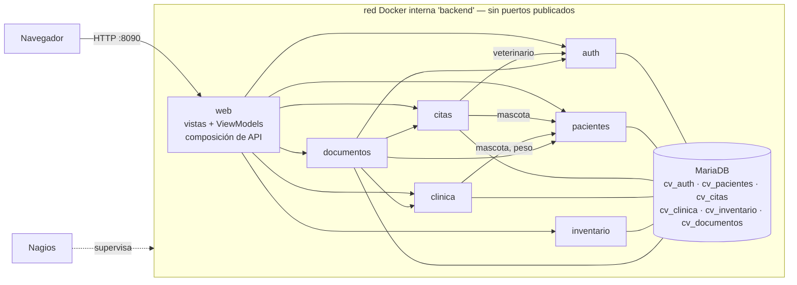

# Arquitectura de ControlVet v1.1 (microservicios)

> Página de Confluence: **ControlVet › Code › Arquitectura**. Responsables: Santiago Gonzalez y Sebastian Gomez.

## 1. Punto de partida

La versión 1.0.0 (etiqueta Git `v1.0.0-monolito`) era un monolito PHP 8.2 con patrón MVVM ejecutado en XAMPP: un `index.php` frontal, 9 modelos con SQL directo sobre una base `controlvet` compartida y JOIN entre todas las tablas. No contenía código Java.

## 2. Vista general



## 3. Límites de responsabilidad y propiedad de datos

| Servicio | Responsabilidad | Datos propios (esquema) | Usuario BD | Depende de | Responsable |
|---|---|---|---|---|---|
| auth | Login, JWT, usuarios, roles | `cv_auth`: roles, usuarios | `auth_svc` | — | Santiago Gonzalez |
| pacientes | Propietarios y mascotas | `cv_pacientes`: propietarios, mascotas | `pacientes_svc` | — | Sebastian Gomez |
| citas | Agenda y estados | `cv_citas`: citas | `citas_svc` | pacientes, auth | Santiago Gonzalez |
| clinica | Historia clínica inmutable, fórmulas | `cv_clinica`: historias_clinicas, formulas_medicas | `clinica_svc` | pacientes | Sebastian Gomez |
| inventario | Productos y stock | `cv_inventario`: productos | `inventario_svc` | — | Sebastian Gomez |
| documentos | PDF y registro de documentos | `cv_documentos`: documentos | `documentos_svc` | citas, clinica, pacientes, auth | Santiago Gonzalez |
| web | Interfaz MVVM original, sesión, CSRF | ninguno (sin credenciales de BD) | — | todos | Ambos |

Contratos API detallados: `services/<servicio>/README.md`.

## 4. Estructura interna obligatoria de cada servicio

```
services/<servicio>/
├── controller/      rutas HTTP, autorización por rol, respuestas JSON
├── validador/       validación de entrada en el servidor (422 con errores por campo)
├── microservicio/   reglas de negocio (Service), puertos (interfaces) y adaptadores (PDO, HTTP)
├── public/index.php punto de entrada (Apache FallbackResource)
├── database/        esquema y datos semilla propios
├── tests/Unit       PHPUnit con dobles en memoria
├── Dockerfile       imagen propia (multi-etapa: Composer → php:8.2-apache)
└── composer.json    dependencias propias + composer.lock
```

`libs/kernel` es una librería **transversal** versionada (router, petición/respuesta, JWT, logger JSON, validador base, `/health`). No contiene lógica de negocio ni conexiones: cada servicio crea la suya con sus propias variables `DB_*`.

## 5. Comunicación

- **Síncrona HTTP/JSON** dentro de la red `backend`. Los nombres de servicio de Docker son las direcciones (`http://pacientes`).
- **Propagación de identidad:** cada llamada reenvía el JWT del usuario; el servicio destino aplica sus propias reglas (no hay cuentas de servicio con privilegios globales).
- **Correlación:** cabecera `X-Request-Id` registrada en los logs JSON de cada servicio.
- **Fallos:** un servicio dependiente caído se traduce en 503 controlado; el frontend muestra "Servicio temporalmente no disponible".

## 6. Seguridad

| Control | Implementación |
|---|---|
| Autenticación | JWT HS256 emitido por `auth`; secreto por variable de entorno (≥ 32 caracteres), verificación de `alg` e `iss` |
| Autorización | Rol verificado en el frontend **y** en cada servicio |
| Aislamiento de datos | Claim `propietario_id` del cliente aplicado en pacientes, citas, clinica y documentos |
| Aislamiento de persistencia | Un usuario MariaDB por servicio, solo DML sobre su esquema (probado en `AislamientoBaseDatosTest`) |
| Red | Solo `web` publica puerto; `backend` es `internal: true` |
| CSRF | Token por sesión en formularios y enlaces que modifican datos |
| Secretos | Nada en Git: `.env` generado por Ansible (0600), `.env.example` como plantilla, control en el pipeline |
| Errores | Sin detalles internos en respuestas; logs estructurados con datos sensibles enmascarados |

## 7. Conservación de funcionalidades

El frontend conserva las mismas rutas `?route=`, vistas y ViewModels de v1.0.0. Los modelos mantienen sus firmas, pero ahora llaman a las APIs y **componen** los datos (`web/core/Composicion.php`) para entregar a las vistas exactamente las mismas claves que antes devolvían los JOIN. La suite `RegresionWebTest` recorre las pantallas por rol para demostrarlo.

Cambios de comportamiento deliberados (mejoras de seguridad o correcciones):

1. El veterinario solo marca como atendidas **sus** citas (antes podía cambiar cualquier cita a cualquier estado).
2. No se permite doble reserva del mismo veterinario en la misma fecha y hora.
3. Un administrador no puede desactivar su propia cuenta.
4. Las credenciales de demostración solo se muestran con `APP_ENV=dev`.
5. Los PDF muestran correctamente tildes y ñ.
6. Las acciones que modifican datos exigen token CSRF.
